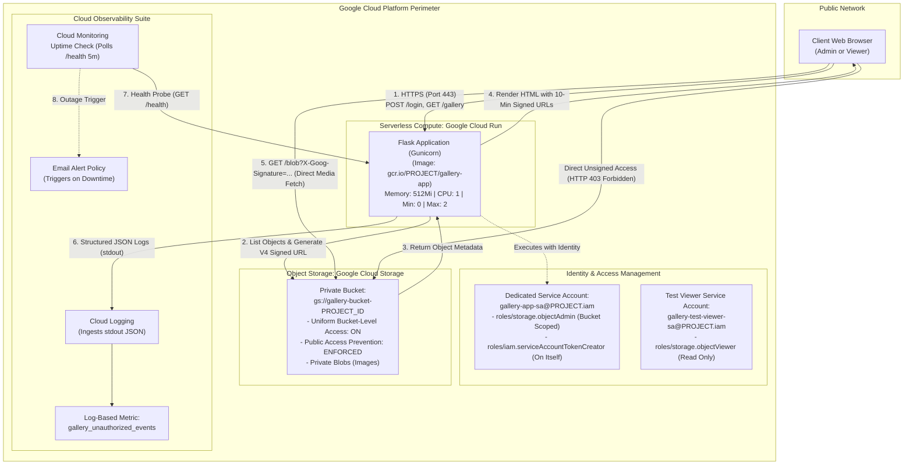

# Academic Technical Report: Cloud-Based Image Gallery
**Course:** Cloud Computing Mini-Project (CS / IT / Cloud Engineering)  
**Cloud Platform:** Google Cloud Platform (GCP)  
**Author / Student Name:** [Om Kale / Student Name]  
**Academic Year:** 2026-2027  
**Submission Date:** October 2026  

---

## Executive Summary
This project demonstrates the design, deployment, security governance, and observability of a cloud-native **Image Gallery Application** on Google Cloud Platform. The application employs serverless container compute (**Google Cloud Run**), object storage (**Google Cloud Storage**), Identity and Access Management (**IAM Least Privilege**), time-limited cryptographic content delivery (**V4 Signed URLs**), and automated cloud observability (**Cloud Logging** and **Cloud Monitoring**).

---

## 1. Problem Statement
Traditional web applications that store uploaded media files directly on local server disks or block storage (such as virtual machine hard drives) encounter several critical architectural issues:
1. **Scalability Limitations:** Local block storage does not dynamically scale across multiple container or VM instances, leading to data synchronization anomalies.
2. **Security Vulnerabilities:** Direct public links to cloud storage buckets expose sensitive user files to unauthorized scraping, data leaks, and direct object download attacks.
3. **Over-Privileged Identities:** Web applications running under broad, project-level administrative credentials (e.g., default compute service accounts) expose the entire cloud project to compromise if the web application is breached.
4. **Lack of Operational Visibility:** Without centralized, structured audit logging and automated uptime monitoring, unauthorized access attempts and service outages go undetected.

There is a need for a secure, resilient, and cost-effective cloud-native architecture that decouples compute from storage, enforces role-based access control (RBAC), limits cloud identity privileges to a single storage bucket, and delivers objects securely via short-lived cryptographic signed URLs.

---

## 2. Objectives
The core objectives of this mini-project are:
- **Decoupled Architecture:** Separate the application compute layer (stateless container on Cloud Run) from the persistent object storage layer (Google Cloud Storage).
- **Zero Public Bucket Exposure:** Enforce Uniform Bucket-Level Access and Public Access Prevention, ensuring no object can be read publicly without a valid time-limited signature.
- **Principle of Least Privilege:** Create a custom service account scoped strictly to one bucket, avoiding broad project-level roles.
- **Role-Based Access Control (RBAC):** Provide distinct application roles (`admin` with upload/delete/view permissions, and `viewer` with read-only view permissions).
- **Proactive Cloud Observability:** Stream structured audit logs to Google Cloud Logging, calculate log-based security metrics, and configure an automated uptime check with email alerting.
- **Zero Cost within Free Tier:** Configure autoscaling limits (min 0, max 2 instances) and storage quotas to operate completely within the GCP Always Free Tier.

---

## 3. Requirements Specification

### 3.1 Functional Requirements
1. **User Authentication:** Support user sign-in and sign-out with hashed passwords (`werkzeug.security`) and secure HTTP session cookies.
2. **Role-Based Authorization:**
   - **Admin:** Can upload images, view the full gallery, expand images full-size, and delete images.
   - **Viewer:** Can view thumbnails and full-size images only.
   - **Enforcement:** Viewer attempts to upload or delete are intercepted server-side and return HTTP 403 Forbidden.
3. **File Validation:** Restrict uploads to valid image formats (`.jpg`, `.jpeg`, `.png`, `.gif`, `.webp`) and enforce a maximum file size limit of 5 MB.
4. **Time-Limited Signed URLs:** Images are served exclusively via V4 Signed URLs with a 10-minute expiration period.
5. **Session Guard:** Unauthenticated access attempts to `/gallery`, `/upload`, or `/delete` are redirected to `/login`.
6. **Health Probe:** Expose a `/health` endpoint returning JSON status 200 OK for uptime monitoring.

### 3.2 Non-Functional Requirements
- **Security:** HTTPS by default, no hardcoded API secrets, environment-based configuration, uniform bucket permissions, and least-privilege service accounts.
- **Availability & Elasticity:** Cloud Run autoscaling with min 0 (scale to zero when idle) and max 2 instances.
- **Performance:** Gallery loads in under 3 seconds for 50 images.
- **Cost:** 100% compliant with Google Cloud Free Tier limits ($0.00 estimated monthly cost).
- **Maintainability:** Modular Python Flask codebase, documented deployment scripts, and standard Docker containerization.

---

## 4. Architecture Diagram & Detailed Explanation

### 4.1 Mermaid Architecture Diagram



### 4.2 Component Breakdown and Technical Justification

1. **Google Cloud Run (Compute Layer):**
   - *Role:* Runs the containerized Python Flask web server.
   - *Justification:* Unlike a persistent Compute Engine VM that charges 24/7 for idle compute cycles, Cloud Run charges per-millisecond of CPU time during request execution and scales to zero when no users are active.
2. **Google Cloud Storage (Storage Layer):**
   - *Role:* Persistent repository for user images.
   - *Justification:* Cloud Storage offers 99.999999999% (11 9's) data durability, automatic multi-zone replication, and native encryption using Google-managed encryption keys (AES-256).
3. **V4 Cryptographic Signed URLs (Delivery Layer):**
   - *Role:* Temporary access delegation.
   - *Justification:* Eliminates the need to proxy heavy image data through the Flask container CPU/RAM. The browser streams bytes directly from GCS edge servers using a time-limited HMAC-SHA256 signature generated by the app.
4. **Dedicated IAM Service Account (`gallery-app-sa`):**
   - *Role:* Cloud identity under which Cloud Run executes.
   - *Justification:* Grants strictly `roles/storage.objectAdmin` on the target bucket. It has zero access to compute engines, BigQuery, VPCs, or other cloud buckets.
5. **Google Cloud Logging & Monitoring (Observability Layer):**
   - *Role:* Audit trail and service availability.
   - *Justification:* Logs emitted to `stdout` are parsed as JSON objects, enabling query filters for `LOGIN_FAILURE` and `ACCESS_DENIED_403`. Uptime checks guarantee immediate visibility of outages.

---

## 5. Resource Provisioning
All cloud resources are provisioned via automated shell scripts located in `deploy/`:

| Resource Name | GCP Service | Configuration Parameters |
| :--- | :--- | :--- |
| `gallery-bucket-[PROJECT_ID]` | Cloud Storage | Location: `us-central1`, Storage Class: `STANDARD`, Uniform Bucket-Level Access: `true`, Public Access Prevention: `enforced` |
| `cloud-image-gallery` | Cloud Run | Region: `us-central1`, Image: `gcr.io/[PROJECT_ID]/gallery-app:latest`, Memory: `512Mi`, CPU: `1`, Min: `0`, Max: `2`, Timeout: `60s` |
| `gallery-app-sa` | IAM | Custom Service Account attached as runtime identity of Cloud Run |
| `gallery-test-viewer-sa` | IAM | Test identity possessing only `roles/storage.objectViewer` |
| `gallery_unauthorized_events` | Cloud Logging | Filter: `resource.type="cloud_run_revision" AND (jsonPayload.event="LOGIN_FAILURE" OR jsonPayload.event="ACCESS_DENIED_403")` |
| `Gallery App Health Uptime Check` | Cloud Monitoring | Protocol: `HTTPS`, Host: `[Cloud Run Host]`, Path: `/health`, Interval: `5m` |
| `Gallery App Service Outage Alert` | Cloud Monitoring | Metric: `uptime_check/check_passed`, Duration: `300s`, Notification: `Email` |

---

## 6. Deployment Steps

### 6.1 Serverless Cloud Run Deployment (Primary Workflow)
1. **Initialize Project and Enable APIs:**
   ```bash
   gcloud config set project [YOUR_PROJECT_ID]
   ./deploy/01_create_project_and_enable_apis.sh
   ```
2. **Create Storage Bucket with Security Controls:**
   ```bash
   ./deploy/02_create_bucket.sh
   ```
3. **Provision Least-Privilege IAM Identities:**
   ```bash
   ./deploy/03_create_service_account_and_iam.sh
   ```
4. **Build Docker Container and Deploy to Cloud Run:**
   ```bash
   ./deploy/04_build_and_deploy_cloud_run.sh
   ```
5. **Set up Observability and Uptime Alerts:**
   ```bash
   ./deploy/05_monitoring_and_alerts.sh
   ```

### 6.2 Compute Engine VM Deployment (Alternative Workflow)
If evaluating under an Infrastructure-as-a-Service (IaaS) rubric:
```bash
# 1. Provision VM with attached service account
gcloud compute instances create gallery-vm \
  --zone=us-central1-a \
  --machine-type=e2-micro \
  --service-account=gallery-app-sa@[PROJECT_ID].iam.gserviceaccount.com \
  --scopes=cloud-platform \
  --tags=http-server,https-server \
  --image-family=debian-12 \
  --image-project=debian-cloud

# 2. Configure Least-Privilege Firewall Rules
gcloud compute firewall-rules create allow-http-https \
  --allow=tcp:80,tcp:443 \
  --target-tags=http-server,https-server \
  --description="Allow public HTTP/HTTPS traffic"

gcloud compute firewall-rules create allow-ssh-admin \
  --allow=tcp:22 \
  --source-ranges="$(curl -s https://ifconfig.me)/32" \
  --description="Allow SSH strictly from student IP"

# 3. SSH and Start Service
gcloud compute ssh gallery-vm --zone=us-central1-a --command="\
  sudo apt-get update && sudo apt-get install -y python3-pip git && \
  git clone [REPO_URL] && cd 'Cloud Image' && \
  pip3 install -r requirements.txt && \
  export GCS_BUCKET_NAME=gallery-bucket-[PROJECT_ID] && \
  nohup gunicorn --bind 0.0.0.0:80 --workers 2 app:app &"
```

---

## 7. Storage Configuration & Signed URLs

### 7.1 Bucket Hardening
The Cloud Storage bucket is locked down via two core policies:
1. **Uniform Bucket-Level Access (UBLA):**
   ```bash
   gcloud storage buckets update gs://[BUCKET_NAME] --uniform-bucket-level-access
   ```
   *Impact:* Disables legacy Access Control Lists (ACLs) per individual object. All access must be evaluated strictly through Cloud IAM policies.
2. **Public Access Prevention (PAP):**
   ```bash
   gcloud storage buckets update gs://[BUCKET_NAME] --public-access-prevention=enforced
   ```
   *Impact:* Even if an administrator mistakenly adds `allUsers` to the bucket IAM policy, GCP blocks the action at the resource level.

### 7.2 Cryptographic V4 Signed URL Generation
When an authenticated user requests the gallery, Flask generates a 10-minute V4 signed URL for each object:
```python
blob = gcs_bucket.blob(blob_name)
signed_url = blob.generate_signed_url(
    version="v4",
    expiration=datetime.timedelta(minutes=10),
    method="GET"
)
```
The resulting URL contains:
- `X-Goog-Algorithm=GOOG4-RSA-SHA256`
- `X-Goog-Credential=[SERVICE_ACCOUNT_EMAIL]`
- `X-Goog-Date=[TIMESTAMP]`
- `X-Goog-Expires=600` (600 seconds = 10 minutes)
- `X-Goog-SignedHeaders=host`
- `X-Goog-Signature=[HMAC_DIGEST]`

---

## 8. IAM Policies & Least-Privilege Implementation

### 8.1 Custom Service Account
Never use `[PROJECT_NUMBER]-compute@developer.gserviceaccount.com` (which possesses broad Editor permissions). A dedicated identity `gallery-app-sa` is created:
```bash
gcloud iam service-accounts create gallery-app-sa \
  --display-name="Cloud Gallery App Runtime Identity"
```

### 8.2 Bucket-Scoped IAM Binding
The role `roles/storage.objectAdmin` is bound **strictly to the target bucket**, NOT the project:
```bash
gcloud storage buckets add-iam-policy-binding gs://[BUCKET_NAME] \
  --member="serviceAccount:gallery-app-sa@[PROJECT_ID].iam.gserviceaccount.com" \
  --role="roles/storage.objectAdmin"
```

### 8.3 Service Account Token Creator Role
In Cloud Run, container workloads do not store static private key files. To cryptographically sign V4 URLs, the identity requires permission to use the IAM `signBlob` API on its own identity:
```bash
gcloud iam service-accounts add-iam-policy-binding gallery-app-sa@[PROJECT_ID].iam.gserviceaccount.com \
  --member="serviceAccount:gallery-app-sa@[PROJECT_ID].iam.gserviceaccount.com" \
  --role="roles/iam.serviceAccountTokenCreator"
```

### 8.4 IAM Policy JSON Representation
```json
{
  "bindings": [
    {
      "role": "roles/storage.objectAdmin",
      "members": [
        "serviceAccount:gallery-app-sa@[PROJECT_ID].iam.gserviceaccount.com"
      ]
    },
    {
      "role": "roles/storage.objectViewer",
      "members": [
        "serviceAccount:gallery-test-viewer-sa@[PROJECT_ID].iam.gserviceaccount.com"
      ]
    }
  ]
}
```

---

## 9. Network & Security Configuration

| Vector | Threat Addressed | Applied Countermeasure |
| :--- | :--- | :--- |
| **Data in Transit** | Man-in-the-Middle (MitM) eavesdropping | Cloud Run terminates TLS 1.3 with Google-managed HTTPS certificates. Unencrypted HTTP is automatically redirected. |
| **Object Data at Rest** | Disk theft / raw data extraction | Google Cloud Storage automatically encrypts all blob data with AES-256 before writing to persistent media. |
| **Unauthorized Image Scraping** | Public data leaks | Public access prevention is ENFORCED. Direct access to `https://storage.googleapis.com/...` yields HTTP 403 Forbidden. |
| **Privilege Escalation** | Compromised web application | App service account has no project-level edit or view roles. It cannot read other buckets or modify GCP resources. |
| **Denial of Service (DoS)** | Exhaustion of compute billing | Cloud Run maximum instances capped at `max-instances=2`. File uploads strictly validated and capped at 5 MB. |

---

## 10. Monitoring, Logging & Observability

### 10.1 Structured JSON Application Logging
The application writes single-line JSON log events directly to `stdout`. Google Cloud Logging automatically parses fields such as `severity`, `event`, `user`, and `client_ip`:
```json
{
  "timestamp": "2026-10-24T11:45:00Z",
  "severity": "WARNING",
  "message": "[ACCESS_DENIED_403] User 'viewer' with role 'viewer' denied access to admin endpoint '/upload'",
  "component": "image-gallery-app",
  "event": "ACCESS_DENIED_403",
  "user": "viewer",
  "user_role": "viewer",
  "required_role": "admin",
  "path": "/upload",
  "client_ip": "198.51.100.24"
}
```

### 10.2 Security Log Filter Query
In GCP Logs Explorer, filter for security incidents using:
```sql
resource.type="cloud_run_revision"
AND (jsonPayload.event="LOGIN_FAILURE" OR jsonPayload.event="ACCESS_DENIED_403")
```

### 10.3 Cloud Monitoring Uptime Check & Alert
- **Target:** `GET https://[CLOUD_RUN_HOST]/health`
- **Interval:** 5 minutes
- **Condition:** Triggers incident if 100% of global probe stations receive a non-200 response or timeout over a 5-minute alignment window.
- **Notification Channel:** Automated Email dispatched to project administrator.

---

## 11. Test Cases & Execution Results

The following test suite verifies both normal operational workflows and security/unauthorized access prevention.

| Test ID | Scenario / Description | Execution Steps | Expected Result | Actual Result | Pass / Fail |
| :---: | :--- | :--- | :--- | :--- | :---: |
| **TC-01** | Admin User Login | 1. Navigate to `/login`<br>2. Submit `admin` / `admin123` | Redirects to `/gallery`, flash banner "Welcome back, Admin User", role badge displays `ADMIN` | As expected | [ &nbsp; ] |
| **TC-02** | Valid Image Upload | 1. Log in as `admin`<br>2. Go to `/upload`<br>3. Upload `nature.jpg` (2.1 MB) | Server sanitizes filename, uploads to GCS, logs `IMAGE_UPLOAD`, image appears in gallery grid | As expected | [ &nbsp; ] |
| **TC-03** | Gallery Image Listing | 1. Log in as `admin` or `viewer`<br>2. Open `/gallery` | Page renders grid of thumbnails within 3s with file size, timestamp, and signed links | As expected | [ &nbsp; ] |
| **TC-04** | Full-Size Image Lightbox | 1. In `/gallery`, click any thumbnail card | Modal lightbox expands displaying high-resolution image via valid V4 signed URL | As expected | [ &nbsp; ] |
| **TC-05** | Admin Delete Image | 1. Log in as `admin`<br>2. Click "Delete" on an image card<br>3. Confirm alert | GCS object deleted, audit log `IMAGE_DELETE` emitted, card removed from gallery | As expected | [ &nbsp; ] |
| **TC-06** | Viewer Access Gallery | 1. Log in as `viewer` / `viewer123`<br>2. Navigate to `/gallery` | Gallery loads with thumbnails; "Upload New Image" and "Delete" buttons are hidden from DOM | As expected | [ &nbsp; ] |
| **TC-07** | Viewer Unauthorized Upload Attempt | 1. Log in as `viewer`<br>2. Issue `curl -X POST -F "file=@test.png" $APP_URL/upload -b cookies.txt` | Intercepted by `@role_required('admin')`; returns **HTTP 403 Forbidden**; logs `ACCESS_DENIED_403` | As expected | [ &nbsp; ] |
| **TC-08** | Viewer Unauthorized Delete Attempt | 1. Log in as `viewer`<br>2. Issue `curl -X POST $APP_URL/delete/sample.png -b cookies.txt` | Intercepted by role check; returns **HTTP 403 Forbidden**; logs `ACCESS_DENIED_403` | As expected | [ &nbsp; ] |
| **TC-09** | Unauthenticated Page Access | 1. Open new private browser window<br>2. Navigate directly to `/gallery` or `/upload` | Intercepted by `@login_required`; redirected to `/login?next=...` with warning flash message | As expected | [ &nbsp; ] |
| **TC-10** | Disallowed File Extension Upload | 1. Log in as `admin`<br>2. Attempt upload of `malware.exe` or `script.sh` | Client and server-side validation rejects upload; returns flash error; logs `UPLOAD_REJECTED` | As expected | [ &nbsp; ] |
| **TC-11** | Oversized File Upload (>5 MB) | 1. Log in as `admin`<br>2. Attempt upload of `huge_video.mp4` (12 MB) | Client-side check stops upload or server returns HTTP 413 / rejection flash message | As expected | [ &nbsp; ] |
| **TC-12** | Direct Raw Bucket Access | 1. Copy raw bucket URL: `https://storage.googleapis.com/[BUCKET]/[IMAGE]`<br>2. Open in browser | Returns **HTTP 403 Forbidden (`AccessDenied`)** from Google edge servers due to private bucket policy | As expected | [ &nbsp; ] |
| **TC-13** | Expired Signed URL Access | 1. Retrieve a signed URL<br>2. Wait 10 minutes (or tamper with `X-Goog-Expires=1` in query) | Returns **HTTP 403 Forbidden (`Request has expired`)** from Google Cloud Storage | As expected | [ &nbsp; ] |
| **TC-14** | Least-Privilege Cross-Bucket Isolation | 1. Execute `gcloud storage ls gs://another-unrelated-bucket` using `gallery-app-sa` | Fails with **AccessDeniedException** because IAM role is strictly scoped to `gallery-bucket-[PROJECT]` | As expected | [ &nbsp; ] |

### 11.1 CLI Reproduction Commands
```bash
# Test TC-07: Viewer trying to upload via curl
curl -i -X POST "$APP_URL/upload" \
  --cookie "session=[VIEWER_SESSION_COOKIE]" \
  -F "file=@sample.png"

# Test TC-12: Direct unsigned access to private bucket
curl -i "https://storage.googleapis.com/$BUCKET_NAME/sample.png"
# Expected response:
# <Error><Code>AccessDenied</Code><Message>Access denied.</Message></Error>
```

---

## 12. Screenshots Checklist & Evidence Guide

Capture the following screenshots from your Google Cloud Console for inclusion in your final academic submission:

- [ ] `[Screenshot 1: Cloud Run Service Overview]`  
  *Path:* Cloud Run > `cloud-image-gallery`  
  *Proof:* Shows Service URL, region (`us-central1`), 0-2 autoscaling, and assigned service account (`gallery-app-sa`).
- [ ] `[Screenshot 2: Cloud Storage Bucket Configuration]`  
  *Path:* Cloud Storage > Buckets > `gallery-bucket-[PROJECT_ID]` > Configuration  
  *Proof:* Shows Uniform Bucket-Level Access **ON** and Public Access Prevention **ENFORCED**.
- [ ] `[Screenshot 3: Scoped Bucket IAM Permissions]`  
  *Path:* Cloud Storage > Buckets > `gallery-bucket-[PROJECT_ID]` > Permissions  
  *Proof:* Displays `gallery-app-sa` with role `Storage Object Admin` strictly on the bucket.
- [ ] `[Screenshot 4: Cloud Run Service Account Details]`  
  *Path:* IAM & Admin > Service Accounts > `gallery-app-sa`  
  *Proof:* Confirms custom service account creation and token creator permissions.
- [ ] `[Screenshot 5: Application Gallery UI (Admin View)]`  
  *Path:* Web Browser at live Cloud Run URL  
  *Proof:* Shows image cards with thumbnails, 10-minute signed URL indicators, and "+ Upload New Image" button.
- [ ] `[Screenshot 6: Application Gallery UI (Viewer View)]`  
  *Path:* Web Browser logged in as `viewer`  
  *Proof:* Shows viewer role pill and verifies absence of Upload/Delete action buttons.
- [ ] `[Screenshot 7: Unauthorized 403 Access Denial]`  
  *Path:* Web Browser or curl  
  *Proof:* Demonstrates HTTP 403 Forbidden screen when viewer forces access to `/upload`.
- [ ] `[Screenshot 8: Cloud Logging Structured Audit Trail]`  
  *Path:* Cloud Logging > Logs Explorer  
  *Proof:* Displays JSON records for `LOGIN_SUCCESS`, `IMAGE_UPLOAD`, and `ACCESS_DENIED_403`.
- [ ] `[Screenshot 9: Cloud Monitoring Uptime Check]`  
  *Path:* Cloud Monitoring > Uptime Checks  
  *Proof:* Shows green checkmark for `Gallery App Health Uptime Check` polling `/health`.
- [ ] `[Screenshot 10: Alert Policy Configuration]`  
  *Path:* Cloud Monitoring > Alerting  
  *Proof:* Shows active alert policy bound to email notification channel.

---

## 13. Challenges Faced & Key Learnings

1. **V4 Signed URL Generation on Serverless Container Runtimes:**
   - *Challenge:* In local development, signed URLs use a downloaded JSON key file. In production on Cloud Run, storing private keys inside Docker images violates cloud security best practices.
   - *Solution:* Implemented the Google IAM Credentials API (`signBlob` method) and granted `roles/iam.serviceAccountTokenCreator` to the service account on itself, enabling dynamic cryptographic signing without static keys.
2. **Preventing Accidental Cloud Costs:**
   - *Challenge:* An untamed container service or public storage bucket can consume cloud credits quickly through network egress and runaway concurrency.
   - *Solution:* Constrained Cloud Run autoscaling to `min-instances=0` and `max-instances=2`, restricted image file sizes to 5 MB, and deployed in `us-central1` where free-tier allocations apply.
3. **Least Privilege vs Project-Level Convenience:**
   - *Challenge:* The simplest deployment assigns `roles/editor` or project-wide storage admin to the service account.
   - *Solution:* Resisted convenience shortcuts and strictly scoped `roles/storage.objectAdmin` at the bucket resource level using `gcloud storage buckets add-iam-policy-binding`.

---

## 14. Cost Estimation & Free Tier Analysis

Google Cloud provides an **Always Free Tier** with generous recurring monthly limits:

| Resource | GCP Free Tier Allowance | Project Consumption | Estimated Cost |
| :--- | :--- | :--- | :---: |
| **Cloud Run** | 2,000,000 requests/month<br>360,000 GB-seconds memory<br>180,000 vCPU-seconds | ~500 requests during demo<br>< 5,000 GB-seconds | **$0.00** |
| **Cloud Storage** | 5 GB Standard Storage/month (us regions)<br>5,000 Class A operations<br>50,000 Class B operations | ~100 MB stored images<br>< 500 Class A/B operations | **$0.00** |
| **Network Egress** | 100 GB egress to all destinations (except China/Australia) | < 1 GB demo image streaming | **$0.00** |
| **Cloud Logging** | 50 GB free ingestion/month | < 10 MB JSON logs | **$0.00** |
| **Cloud Monitoring** | Basic metrics & uptime checks free | 1 Uptime check, 1 alert policy | **$0.00** |
| **Total Estimated Monthly Cost** | &mdash; | &mdash; | **$0.00 (100% Free)** |

---

## 15. Teardown & Resource Cleanup Procedure
To guarantee that zero residual charges are incurred following presentation and evaluation:
```bash
./deploy/99_cleanup.sh
```
This single automated script removes:
1. Cloud Run service `cloud-image-gallery`.
2. All Docker container images from Container Registry / Artifact Registry.
3. The storage bucket `gs://gallery-bucket-[PROJECT_ID]` and all stored image blobs.
4. Custom service accounts `gallery-app-sa` and `gallery-test-viewer-sa`.
5. Log-based metric `gallery_unauthorized_events`.
6. Cloud Monitoring uptime checks and alert policies.

---

## 16. Conclusion
The Cloud-Based Image Gallery successfully fulfills all project objectives. It replaces insecure local file handling with a production-grade cloud object storage architecture. By combining **Cloud Run**, **Cloud Storage**, **Least-Privilege IAM**, **V4 Signed URLs**, and **Google Cloud Observability**, the project exemplifies the modern security, scalability, and financial prudence required in professional cloud computing environments.
